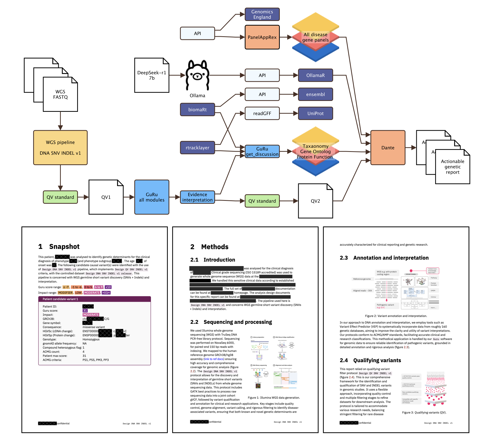
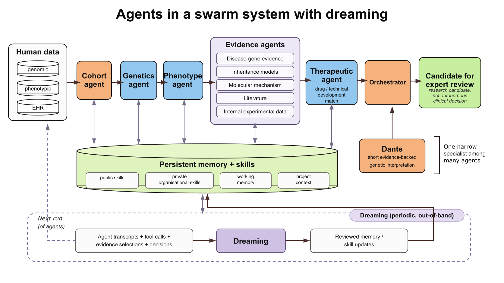

{{ page.date | date: "%Y-%m-%d" }}

We have been working on **dreaming** for agentic AI. It is a periodic, out-of-band process that analyses agent activity and updates persistent memory for future sessions. It improves the context available to later agents while leaving the underlying foundation model unchanged. We use it within a broader architecture that separates stable skills, task-specific retrieval, working memory and longer-term memory consolidation.

Foundation models have broad capabilities but little inherent knowledge of a private organisation. They do not know an internal codebase, deployment procedure, project history, scientific convention or individual working preference unless that information enters the context. Long-running agentic systems therefore need some of this information to persist across otherwise independent sessions.

## Skills and external memory

The simplest persistent context is a skill file loaded when an agent starts a task (i.e. _SKILLS.md_). Skills are useful, and we use them extensively. For instance, we built [biologyskills.com](https://biologyskills.com/) and make it freely available as a collection of domain-specific operating rules for biological AI agents. Skills alone, however, do not provide the full context needed by long-running agentic systems.

A skill file (and skills directory) works well for compact operating instructions, but larger collections become inefficient if every file enters every context window. We use **progressive disclosure**, where a skill exposes enough metadata for an agent to judge relevance and loads detailed instructions or references only when needed.

Biology Skills contains reviewed guidance on required context, failure modes, evidence boundaries and expert stop conditions. The same structure can be used privately for repository conventions, deployment procedures, assay rules, validated data sources, reporting requirements or regulated workflows.

Skills and memory have different roles. Skills encode reviewed procedures and domain rules, while memory records information that emerges during work, such as a corrected command, failed tool configuration, project-specific preference or new dependency. Persistent memory therefore adds a dynamic layer that curated skills alone do not provide.

## Retrieval before agent memory

Usually retrieval-augmented generation (RAG) is useful to understand and use before adopting more complex multi-agent systems. For instance, we used it in [PanelAppRex AI](https://switzerlandomics.ch/technologies/panelAppRexAi/). While building, we harmonised curated disease-gene panels, gene identifiers, inheritance information, phenotypes and supporting evidence into a reusable data layer for precision medicine, with the AI-assisted generation of summaries conditioned on the disease panel being examined (Quant group et al., 2026).

Retrieval constrains the evidence before the model receives it. The knowledge about hundreds of interacting proteins is much larger than the information required for a particular disease panel, so the system first selects the relevant biological context and then generates a compact representation. This representation is curated only to the context of the given disease and constituent proteins in that pathway. The curated panel membership remains unchanged. The system is described in the [PanelAppRex explainer](https://switzerlandomics.ch/pages/panelAppRexAi_about/) and the associated [publication](https://doi.org/10.1093/bioadv/vbag115).

RAG can be used to construct context for the current task from a knowledge base. Persistent memory carries useful information between tasks. Dreaming examines accumulated activity across tasks and updates the memory available to future sessions.

## Memory as shared mutable state

Persistent memory becomes a shared mutable state when many agents operate over the same projects. Concurrent writers can overwrite each other, incorrect observations can propagate into later sessions, and old instructions can remain after the underlying system changes. We therefore treat memory updates as versioned operations that retain their originating session, author, time, previous state and supporting evidence.

Concurrent writes can use **optimistic concurrency control**. An agent records a content hash before preparing an edit and verifies the hash again before committing. If another process changed the memory in the meantime, the write fails and the agent reloads the current version before generating a new edit.

Permissions define which memories an agent may modify. Shared organisational knowledge can remain read-only to ordinary agents, while project or agent working memory can permit writes. A common API can expose these stores to different agent interfaces without coupling accumulated knowledge to one model or product.

For instance, we have a private system called **Dante**. It began as a secure HPC deployment for evidence-backed genetic report generation using a DeepSeek open-weight model for document preparation (**Figure 1**). It converted interpreted genomic findings into structured clinical reports, including standardised variant nomenclature, supporting evidence and confidence estimates. We later ended the original reporting workflow and repurposed Dante as an internal agentic system that combines persistent project context, private organisational skills and agent workflows under separate permission and retention rules (**Figure 2**).

**Figure 1. Original Dante reporting architecture**. *Deterministic genomic processing and evidence retrieval surround a local DeepSeek-R1 7B component used for short interpretation text, with Dante assembling the final actionable genetic report.*

**Figure 2. Agentic system architecture**. *Dante was shown in Fig. 1 and here it is included as one specialist agent within a larger workflow, supported by persistent memory and skills, with a separate dreaming loop that consolidates cross-session evidence into reviewed memory updates.*

## The limit of in-band memory

Memory written during task execution is **in-band**. The agent must complete the current task while deciding what future sessions should remember. An agent can record an immediate correction, such as a changed deployment command, but one session cannot easily detect a failure pattern distributed across many other sessions.

Persistent memory also becomes stale. Procedures change, projects evolve and previously useful observations lose relevance. A maintenance process therefore needs a wider temporal view than an individual task agent.

## The dreaming pipeline

Dreaming moves memory maintenance into a separate process with dedicated computation. It receives a snapshot of the current memory together with selected transcripts and execution metadata from recent agent sessions. A compact representation is:

`M_t + selected transcripts → per-session analysis → cross-session aggregation → proposed memory diff → review/commit → M_t+1`

The first stage analyses individual sessions for evidence that may affect persistent memory. Relevant signals include repeated mistakes, missing procedures, tool failures, corrections, recurring preferences and knowledge that agents repeatedly have to rediscover. Analysis can be distributed across multiple agents, with workers examining separate sessions or groups of sessions.

An orchestrator aggregates these analyses across sessions. It distinguishes isolated events from recurrent patterns and can attach supporting sessions, prevalence estimates and a rationale to each proposed update. The result is an evidence-backed diff against the existing memory state.

Dreaming can add new memories, update existing ones, remove obsolete material, merge duplicated information and reorganise content that has become difficult to retrieve. The updated memory state becomes available to subsequent sessions, whose activity later contributes evidence to another consolidation cycle.

This creates two timescales of adaptation. In-band memory captures local information during task execution, while dreaming consolidates evidence across longer periods and multiple agents. The first provides rapid correction; the second provides cross-session maintenance.

## Updating curated skills

The same evidence can reveal gaps in curated skills. If agents repeatedly encounter a biological ambiguity that an existing skill does not address, the dreaming process can propose an addition and attach the sessions that motivated it.

For resources such as Biology Skills, detection and publication remain separate. Proposed changes can be generated automatically, while promotion into a shared scientific skill remains subject to provenance, validation and review. This allows project memory to change quickly while stable domain guidance follows a more controlled process.

## Security and governance

A dreaming process should receive only transcripts compatible with the permissions of the memory it can update. Transcript selection therefore belongs inside the trusted orchestration layer. A team memory can be curated from sessions visible to that team without exposing unrelated user or organisational data.

Language models can interpret sessions, identify patterns and draft memory changes. Access control, provenance, versioning, concurrency checks and commit rules should be enforced deterministically by the surrounding software.

Persistent memory also creates a poisoning risk. Incorrect or malicious information can affect many later sessions once it enters shared context. Dreaming can identify contradictions or stale information, while permissioning, provenance, validation and controlled writes provide the primary safeguards.

Human review can remain in the commit path for high-value or high-risk memory. Lower-risk working memories can use more autonomous update policies. The appropriate boundary depends on the consequence of an incorrect memory propagating into later tasks.

## Designing the whole context system

Skills, retrieval, memory and dreaming address different parts of the context problem. Skills provide reviewed operating knowledge, retrieval selects external information for the current task, in-band memory records useful experience during work, and dreaming maintains persistent memory across sessions.

This architecture produces **continual adaptation at the agent-system level**. The foundation model can remain fixed while the surrounding system accumulates knowledge about its organisation, projects, users and recurring failure modes.

Dreaming adds inference cost because additional agents must inspect transcripts and maintain memory. The expected operational return comes from fewer repeated mistakes, less rediscovery and better context for later sessions. In long-running systems with repeated workflows, memory quality becomes part of the system architecture.

## References

* **[PanelAppRex aggregates disease gene panels and facilitates sophisticated search](https://doi.org/10.1093/bioadv/vbag115)**  
  Quant Group, Simon Boutry, Ali Saadat, Sinisa Savic, Luregn J. Schlapbach, Jacques Fellay, Dylan Lawless. 
  *Bioinformatics Advances* (2026). DOI: [10.1093/bioadv/vbag115](https://doi.org/10.1093/bioadv/vbag115). [PDF](https://academic.oup.com/bioinformaticsadvances/article-pdf/6/1/vbag115/68294343/vbag115.pdf) | [Video](https://vimeo.com/1193244150) | [Application](https://switzerlandomics.ch/technologies/panelAppRexAi/) | [About](https://switzerlandomics.ch/pages/panelAppRexAi_about/)

* **[Biology Skills](https://biologyskills.com/)**.
  Biology Skills contributors. Version 0.1.0. Apache-2.0.  [Website](https://biologyskills.com/) | [Source repository](https://github.com/biologyskills/biology-skills)

