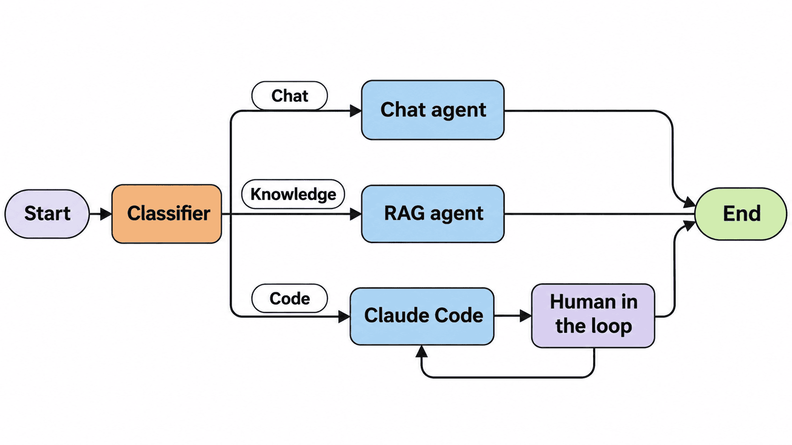
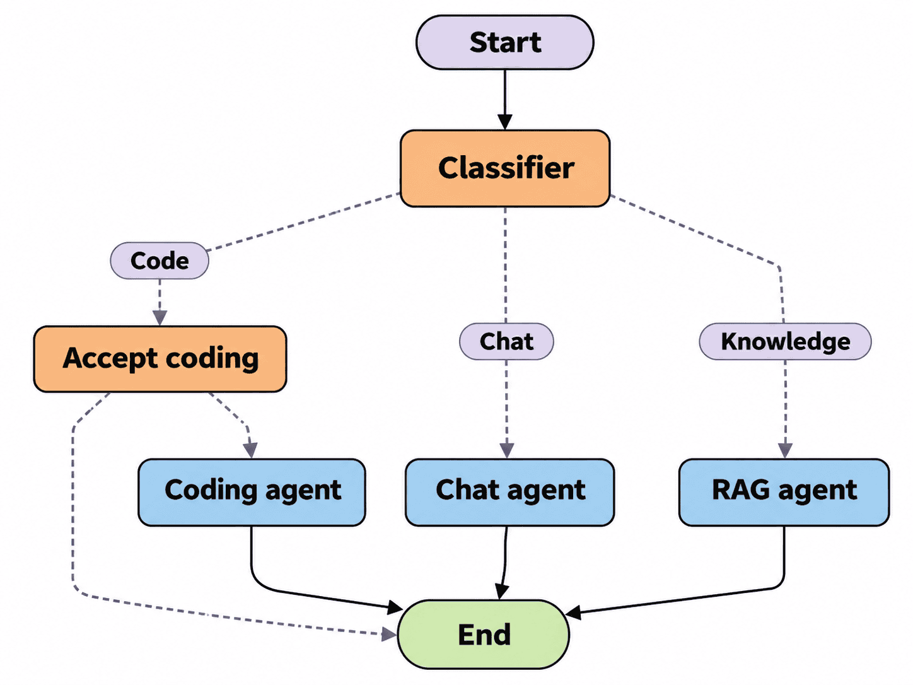
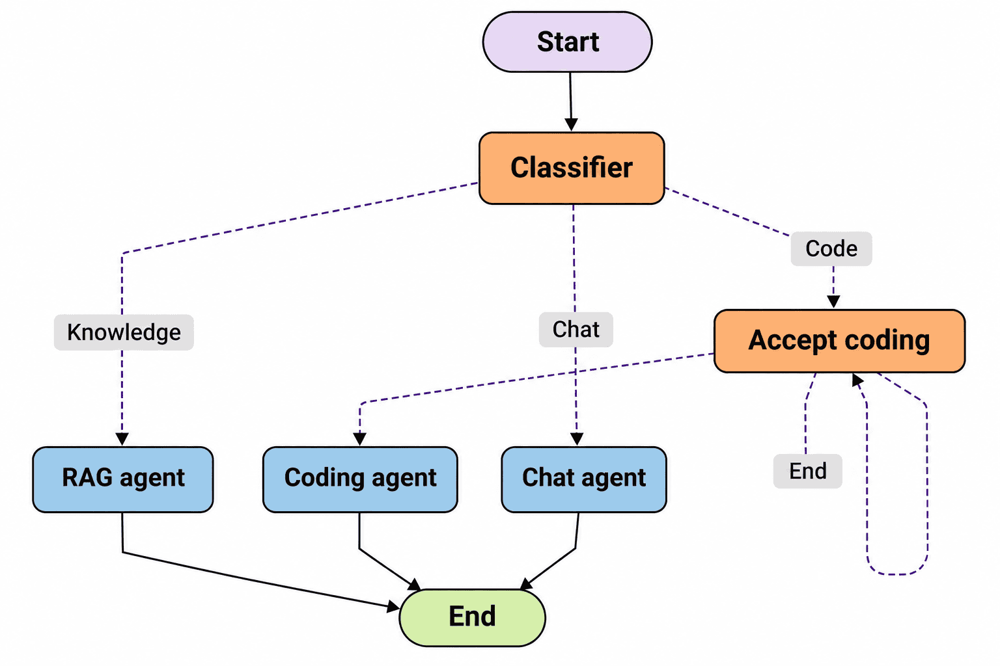
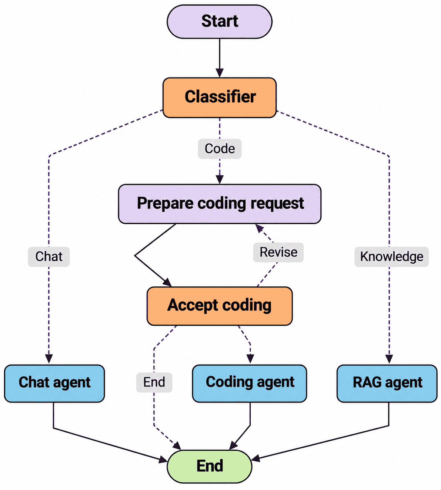

<p>{{ page.date | date: "%Y-%m-%d" }}</p>

We have been building AI tools that work with project files, scientific knowledge and the context accumulated during a task. A language model can answer a question or write code, but a useful agentic system also needs to decide which information to retrieve, which tools to run and when to ask a person before making a change. We assemble workflows directly in whatever language is most suitable. However, the most common approach is to use Python. **LangGraph** offers an open-source way to express the same decisions as an explicit, stateful graph.

In this post we are walking through a simple representation of our Dante system. A task can become a conversation, a search of a knowledge base or an instruction to edit a file. The AI-scalable part is what happens between the request and the action, particularly when the coding agent needs context from an earlier message or the user wants to revise their plan.



*Figure 1. A classifier routes requests to specialist workflows; changes to files introduce an approval step.*

## From models to a workflow

LangChain provides integrations for chat models, embeddings, document stores and tools. LangGraph sits alongside it to organise **nodes** (operations), **edges** (transitions) and shared **state**. This allows us to coordinate different models and tools within the same workflow.

We sometimes work on secure HPC platforms using locally hosted open-weight models. Commercial APIs such as OpenAI are often simpler for rapid development and testing. The choice is flexible: a node might call an OpenAI model, a local LLM, a private retrieval system or an external coding agent. The graph controls how these components interact without requiring them to use the same model.

For a Python implementation, we can install `langgraph`, `langchain`, `langchain-openai`, `python-dotenv`, `pydantic` and `numpy` using `pip` or `uv`. For testing, I often use `init_chat_model("gpt-4.1-mini", model_provider="openai")`, with credentials loaded from `.env`.


The most important concept to realise is that information is structured - whether you are are using ChatGPT in a web browser or some self-hosted model, the content is more than just the input/ouput message.
Even a simple exchange has important metadata. LangChain represents the conversation as structured messages. For example, a shortened LangGraph result looks like this:

```python
{
    "messages": [
        HumanMessage(content="Hello, I need help"),
        AIMessage(
            content="Hello! How can I assist you today?",
            response_metadata={"model_name": "gpt-4.1-mini-2025-04-14"},
            usage_metadata={"input_tokens": 13, "output_tokens": 10},
            tool_calls=[]
        )
    ]
}
```

The `content` contains the conversation, while metadata records information such as model identity, token usage and tool calls. These are useful building blocks for monitoring and agent execution. We can also define our own variables to track what the system is doing, which decisions have been made and which operation should happen next.

In LangGraph, we describe this shared information using a **state schema**. For our example, it is compact:

```python
class AgentState(TypedDict):
    messages: Annotated[list, add_messages]
    message_intent: str | None
    next_node: str | None
```

Each node reads the current state and returns only the fields it changes. The `add_messages` reducer merges new messages into the conversation, while `message_intent` and `next_node` allow us to control the workflow explicitly.

We register operations using `StateGraph(AgentState)` and `builder.add_node(...)`, then connect them using `add_edge(...)` or `add_conditional_edges(...)`. A checkpointer such as `InMemorySaver()` retains state between calls when the same `thread_id` is supplied in `config`. This allows successive operations to share conversation context, although the in-memory version does not survive a process restart.

## Connecting knowledge and tools

A Pydantic classifier constrains the result to `Literal["chat", "knowledge", "code"]`. The graph routes that value to `chat_agent`, `rag_agent` or the coding approval path. Chat is simply `llm.invoke(state["messages"])`. The knowledge route embeds `Document` objects, stores them in an `InMemoryVectorStore`, retrieves matches with `similarity_search(query, k=3)` and places the selected passages into the model's context.

This is the point where a **private knowledge base** can become useful. Instead of asking a model to remember internal procedures, project history or experimental evidence, retrieval supplies the relevant material for the current question. The demonstration uses a small in-memory collection; a private deployment would substitute an access-controlled index and an embedding model compatible with its data-handling requirements.

The coding route is different because it can modify files. There are several ways to provide this capability, including **Claude Code, OpenAI Codex**, or a custom agent that uses a local LLM with filesystem tools. LangGraph is independent of this choice and controls when the coding agent is invoked. For example, we sometimes use Claude Code in headless mode, called from Python using `subprocess.run(["claude", "-p", request, "--permission-mode", "acceptEdits"], cwd=workspace, ...)`. The coding agent handles file inspection and modification, while LangGraph manages the surrounding workflow and approval process.

## Pausing before a file edit

We do not want an ambiguous conversational instruction to edit a project immediately. LangGraph's `interrupt(f"Approve: {request}")` pauses the coding path. The caller presents the proposed instruction and resumes the same thread with `graph.invoke(Command(resume=user_response), config=config)`. The chat and retrieval paths need no such approval step.



*Figure 2. The first executable graph adds a human decision before the coding agent runs.*

Suppose we have already introduced ourselves to the assistant.
Later, we ask it to modify our project:

```text
> You: My name is Inigo Montoya. I am a Spanish fencer
>      and I work for a Sicilian named Vizzini.
> Assistant: Hello Inigo!
> ...
> You: Add an About the author section to README.md.
> Coding approval: Add a new "About the author" section with
>           a heading and several paragraphs about the author.
>           Approve this request? yes/no or other.
> You: Actually, just add a short, professional author credit.
> Coding approval: Add a brief author credit to README.md.
>           Approve this request? yes/no or other.
> You: Yes.
> Result: README.md updated.
```

Approval is rarely just yes or no. We may want to revise an instruction without starting again. LangGraph stores the decision in `next_node`: approval proceeds to `coding_agent`, denial reaches `END`, and a revision returns to `accept_coding` with the updated instruction. The coding agent only executes a request after we explicitly approve it.



*Figure 3. The approval node gains a revision loop rather than treating any new instruction as permission to execute.*

## Passing context between agents

Our approval loop now works, but there is another problem. The main assistant knows who Inigo Montoya is from our earlier conversation. The separately launched coding agent does not automatically receive that history. It might receive only:

```text
> You: Add a short, professional author credit to README.md.
> Assistant: Who is the author? 
```

The instruction is missing the author's name and background, even though the main assistant already knows both.
We solve this by adding `prepare_coding_request`. Before asking for approval, this node uses the conversation history to prepare a complete instruction:

```text
> You: Add a short, professional author credit to README.md.
> Coding agent: working...
> Prepared request: "Add a short, professional author credit 
> to README.md for Inigo Montoya, a Spanish fencer."
```

Now the coding agent receives the relevant context. If we revise the request again, LangGraph returns to `prepare_coding_request`, incorporates our feedback and presents the new instruction for approval. Only the approved version is passed to the coding agent.



*Figure 4. The final graph prepares a context-aware instruction and loops revisions back through that preparation step.*

This separation is useful beyond coding. The orchestration model can be replaced, retrieval can connect to a different knowledge store, and the executor can be a specialist agent without changing the overall workflow. It also makes the boundaries visible. `cwd=workspace` sets a working directory but is not a sandbox; calling Claude Code locally does not necessarily mean its model or data processing is local. Likewise, `OpenAIEmbeddings` sends content to an external service, so a fully private deployment needs a suitable local embedding path. Permissions, process failures and approval of actual changes still require engineering around the graph.

The result is a compact system where we can connect conversation, private knowledge and file operations while keeping their responsibilities separate. 
LangGraph provides the control flow in this example, but it is itself a replaceable framework. The underlying architecture can be implemented with other frameworks or custom code, just as the models and tools can be exchanged without changing the fundamental design.

# Refefences

- **[LangGraph](https://github.com/langchain-ai/langgraph)** by LangChain. Open-source low-level orchestration framework for building stateful agents.

